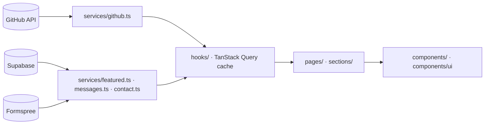

# Raul Azzi Corsi — Portfolio

My personal portfolio: a React single-page app that lists my projects straight from the GitHub API, takes
messages through a validated contact form, and has a private dashboard where I read those messages and choose
which projects are featured on the home page.

**Live:** https://raulacor.vercel.app

## Tech stack

| Concern      | Choice                                                                          |
| ------------ | ------------------------------------------------------------------------------- |
| UI           | React 19 + TypeScript, Vite                                                     |
| Styling      | Tailwind CSS v4 with design tokens, React Bits components                       |
| Motion / 3D  | GSAP, WebGL hero background (DarkVeil) that reacts to the mouse                 |
| Routing      | React Router (`/`, `/projects`, `/projects/:slug`, `/login`, `/dashboard`, 404) |
| Server state | TanStack Query (cache shared by every page)                                     |
| Backend      | Supabase: Auth + Postgres with Row Level Security                               |
| Email        | Formspree                                                                       |
| Tests        | Vitest + Testing Library                                                        |
| Quality      | ESLint, Prettier, Husky, lint-staged, commitlint                                |
| CI / Deploy  | GitHub Actions (checks) + Vercel (deploy on push to `main`)                     |

## Architecture

```
src/
  pages/        one component per route, lazy-loaded (code splitting)
  layouts/      SiteLayout (public), AdminLayout (login + dashboard, loads auth)
  sections/     blocks of the home page
  components/   reusable UI; components/ui holds the primitives (Button, TextField, Spinner, StatusMessage)
  hooks/        data fetching and form logic (useRepos, useFeatured, useMessages, useContactForm, useAuth, useTheme)
  services/     the only code that touches the network (GitHub, Supabase, Formspree)
  contexts/     ThemeProvider, AuthProvider
  lib/          pure functions: validation, formatting, query client
  data/site.ts  static copy and links
supabase/schema.sql   tables + Row Level Security policies
```



Components never call `fetch` themselves: **service → hook → page → presentational component**.

## Getting started

```bash
npm install
cp .env.example .env    # then fill in the values (see below)
npm run dev             # http://localhost:5173
```

| Script               | What it does                               |
| -------------------- | ------------------------------------------ |
| `npm run dev`        | dev server                                 |
| `npm run build`      | type-check + production build into `dist/` |
| `npm run preview`    | serve `dist/` locally                      |
| `npm run lint`       | ESLint                                     |
| `npm run format`     | Prettier (write)                           |
| `npm test`           | Vitest, run once                           |
| `npm run test:watch` | Vitest in watch mode                       |

### Environment variables

See `.env.example`. `.env` is git-ignored.

| Variable                 | Where to find it                                    |
| ------------------------ | --------------------------------------------------- |
| `VITE_GITHUB_USER`       | GitHub username whose repos are listed              |
| `VITE_SUPABASE_URL`      | Supabase → Project Settings → API → Project URL     |
| `VITE_SUPABASE_ANON_KEY` | Supabase → Project Settings → API → anon public key |
| `VITE_FORMSPREE_ID`      | Formspree form id (after `https://formspree.io/f/`) |

### Supabase setup

1. Create a project, open **SQL Editor** and run `supabase/schema.sql` (edit the email in `is_owner()` first).
2. **Authentication → Users → Add user** with that same email and a password. This is the dashboard login.
3. **Authentication → Sign In / Providers**: turn off "Allow new users to sign up".

## Conventions

- **Naming:** components `PascalCase.tsx`; hooks `useThing.ts`; services, utils and context objects `camelCase.ts`;
  tests `Thing.test.tsx` next to the file.
- **Commits:** [Conventional Commits](https://www.conventionalcommits.org) — `type(scope): description`, e.g.
  `feat(contact): validate message length`. Enforced by commitlint on every commit.
- **Branches:** GitHub Flow. `main` is protected and always deployable. Every change gets its own branch
  (`feature/*`, `fix/*`, `chore/*`, `docs/*`) and is merged through a pull request with green CI.
- **Code style:** ESLint + Prettier run on staged files before each commit (Husky + lint-staged) and again in CI.

## AI harness

This project was built with Claude Code. Everything that steers the AI is versioned:

| File                              | Purpose                                                                  |
| --------------------------------- | ------------------------------------------------------------------------ |
| `CLAUDE.md`                       | Project instructions: architecture, naming, git workflow, tests          |
| `.claude/settings.json`           | Allowed/denied commands (no `.env` reads, no pushes to `main`) and hooks |
| `.claude/hooks/guard-main.mjs`    | Blocks `git commit` on `main`                                            |
| `.claude/hooks/format-file.mjs`   | Runs Prettier + ESLint on every file the AI edits                        |
| `.claude/skills/new-feature/`     | Step-by-step feature workflow (branch → code → tests → commit)           |
| `.claude/skills/open-pr/`         | Push and open a PR with the template, then watch CI                      |
| `.claude/agents/code-reviewer.md` | Read-only reviewer that checks a branch against `CLAUDE.md`              |
| `.mcp.json`                       | Supabase MCP (read-only) and Playwright MCP                              |

## Performance

- Mobile Lighthouse performance: 83–92 in local runs (simulated slow 4G, 4× CPU slowdown).
- Every route except home is lazy-loaded; the dashboard, Supabase SDK and WebGL scene are separate chunks.
- Sections below About are prefetched while the browser is idle but only render (and call the APIs) when the
  visitor scrolls near them or opens a deep link such as `/#work`.
- The live WebGL hero runs only on wide screens with a real GPU; phones, software renderers and Save-Data get
  the pre-rendered WebP still.
- Visitors read featured projects through Supabase's REST endpoint with `fetch`, so the SDK never loads for them.
- GitHub data is fetched once and cached for 10 minutes; navigating between pages makes no new requests.
- Skeletons match the final card size and images have fixed dimensions, so the layout doesn't jump.
- Images are WebP, sized per breakpoint; below-the-fold images use `loading="lazy"`.
- Fonts are self-hosted, subset and preloaded; CSS is inlined into `index.html`.

## Deploy

Vercel's GitHub integration builds every push: `main` goes to production and every pull request gets a preview URL.
`vercel.json` rewrites all paths to `index.html`, so shared links like `/projects/ukraid` work on refresh.
Set the four `VITE_*` variables in Vercel → Project → Settings → Environment Variables.
